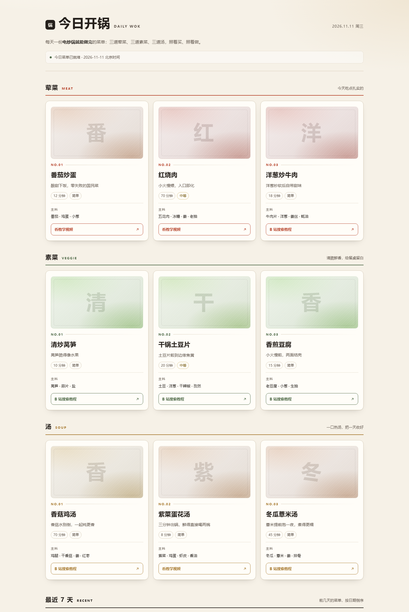
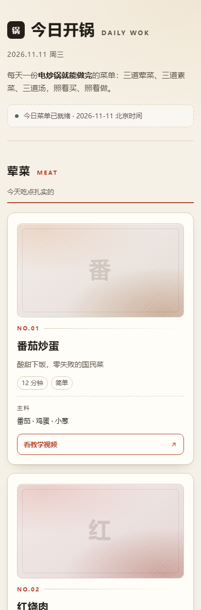

# 今日开锅 · Daily Wok

每天自动生成一份「电炒锅就能做完」的菜单：**3 道荤菜 + 3 道素菜 + 3 道汤**，并带着 B 站教程入口。
没有数据库、没有服务器，靠 GitHub Actions 每天定时生成静态文件，GitHub Pages 托管页面。

## 界面预览

桌面端（≥1200px，三列）：



移动端（390px 视口，单列）：



---

## 它是怎么跑的

```text
GitHub Actions（每天 UTC 16:05 = 北京时间 00:05）
  ↓ node scripts/generate-daily.mjs
读出 data/dishes.psv（90 道菜）+ data/history.json（推荐历史）
  ↓
生成 public/data/today.json，并把当天选菜结果写回 data/history.json
  ↓
自动 commit 回仓库
  ↓
public/ 打包部署到 GitHub Pages
  ↓
浏览器打开页面，读取 data/today.json 渲染
```

几个关键设计：

- **同一天固定**：`history.json` 里有当天记录时直接复用，重跑不会换菜；
- **可复现**：选菜用「日期做种子」的伪随机，即使历史丢失，同一天重算结果也一致；
- **去重窗口**：默认避开最近 9 天出现过的菜（30 道 / 每天 3 道 ≈ 10 天一轮）；
- **最近 7 天**：页面底部列出前 7 天的菜名（来自 `today.json` 的 `recent` 字段，由历史生成）；
- **视频**：已为 12 道高频菜绑定固定 B 站视频（按钮显示「看教学视频」），其余菜品自动跳 B 站搜索「菜名 + 电炒锅 + 教程」。

---

## 目录结构

```text
daily-wok/
├─ data/
│  ├─ categories.json      # 三个分类的标题、英文名、说明、主题色
│  ├─ dishes.psv           # 菜品库：1 行表头 + 90 行菜品，8 字段
│  ├─ history.json         # 推荐历史（生成脚本自动维护）
│  └─ images.json          # 可选：菜品配图 { "菜品id": "图片URL" }
├─ scripts/
│  ├─ generate-daily.mjs   # 每日菜单生成器
│  └─ preview.mjs          # 本地静态预览服务器
├─ public/
│  ├─ index.html           # 单文件页面（内嵌 CSS / JS）
│  └─ data/today.json      # 生成产物（脚本写入）
├─ .github/workflows/
│  └─ daily-menu.yml       # 定时生成 + 提交 + 部署
├─ setup-project.ps1       # 脚手架与自检脚本
└─ package.json
```

### 卡片图区

每张菜卡顶部有一个 **16:9**、圆角、带细内框的图区：

- 默认是 **CSS 生成的渐变插画**（按分类取色 + 菜品 id 微调色相，中间压一个菜名首字的淡色大字），不依赖网络、不会出现破图；
- 想换成真实照片，在 `data/images.json` 里按菜品 id 配 URL 即可，例如：

  ```json
  { "m13": "https://example.com/hongshaorou.jpg", "s01": "https://example.com/fanqietang.jpg" }
  ```

  配了图的菜自动渲染 ``（`object-fit: cover`，加载失败会自动退回渐变），没配的继续用插画。

### `dishes.psv` 字段

`id|name|category|ingredients|minutes|difficulty|note|videoUrl`

- `category` 只能是 `meat` / `veg` / `soup`；
- `ingredients` 用中文顿号 `、` 分隔；
- `minutes` 为纯数字；
- `difficulty` 建议只用 `简单` / `中等` / `稍难`；
- `videoUrl` 可留空（留空则走 B 站搜索兜底）。

> 字段之间用 `|` 分隔，所以任何字段内容里都不能再出现 `|`。

---

## 本地跑起来

需要 **Node.js 20 或更高版本**。

```powershell
cd C:\Users\phoenix\Documents\daily-wok

# 自检：目录、文件、菜品库格式
powershell -NoProfile -ExecutionPolicy Bypass -File .\setup-project.ps1

# 生成今天的菜单
npm run generate        # 等价于 node scripts/generate-daily.mjs

# 本地预览
npm run preview         # 打开 http://127.0.0.1:8000
```

没有 `npm` 也能直接跑：`node scripts/generate-daily.mjs`、`node scripts/preview.mjs`。

生成后应得到 `public/data/today.json`，里面是 3 个分类 × 3 道菜的完整数据。

---

## 第一次发布到 GitHub Pages

1. 新建一个 **Public** 仓库（免费账号的 Pages 对私有仓库有额外限制）；
2. 在项目目录里初始化并推送：

   ```powershell
   git init -b main
   git add .
   git commit -m "chore: 初始化今日开锅"
   git remote add origin https://github.com/<你的用户名>/daily-wok.git
   git push -u origin main
   ```

3. 仓库 `Settings → Pages`：**Source 选 `GitHub Actions`**；
4. 仓库 `Settings → Actions → General`：Workflow permissions 选 **Read and write permissions**（脚本要把生成结果 commit 回仓库）；
5. 仓库 `Actions → Daily Menu Build and Deploy → Run workflow` 手动跑一次；
6. 两个 job（`build` / `deploy`）都变绿后，打开 `https://<你的用户名>.github.io/daily-wok/` 验收。

---

## 日常维护

| 想做的事 | 怎么做 |
|---|---|
| 加菜 | 在 `data/dishes.psv` 追加行，`id` 不要重复，分类数量尽量保持均衡 |
| 换某道菜的视频 | 填上该行的 `videoUrl`，页面会自动改成「看教学视频」 |
| 给某道菜配照片 | 在 `data/images.json` 加 `"菜品id": "图片URL"`，卡片 16:9 图区自动换成真图 |
| 调整去重周期 | 改 `data/history.json` 的 `windowDays`（每类菜品数 ≥ 3 × windowDays 才够用） |
| 换生成时间 | 改 `.github/workflows/daily-menu.yml` 里的 `cron`（UTC 时间） |
| 重挑今天的菜 | 删掉 `data/history.json` 里当天的记录，再跑一次生成 |

注意：`data/history.json` 是去重的唯一依据，误删会导致短期内重复推荐；它由脚本维护，请不要手写格式之外的字段。

---

## 已知限制

- GitHub Actions 的 `schedule` 可能延迟几分钟，页面会自动重试并显示「等待今日更新」；
- 所有访客在同一天看到同一份菜单，不支持个性化、收藏、跨设备同步；
- 视频入口默认是 B 站搜索页，不保证第一条结果就是最合适的教程。
